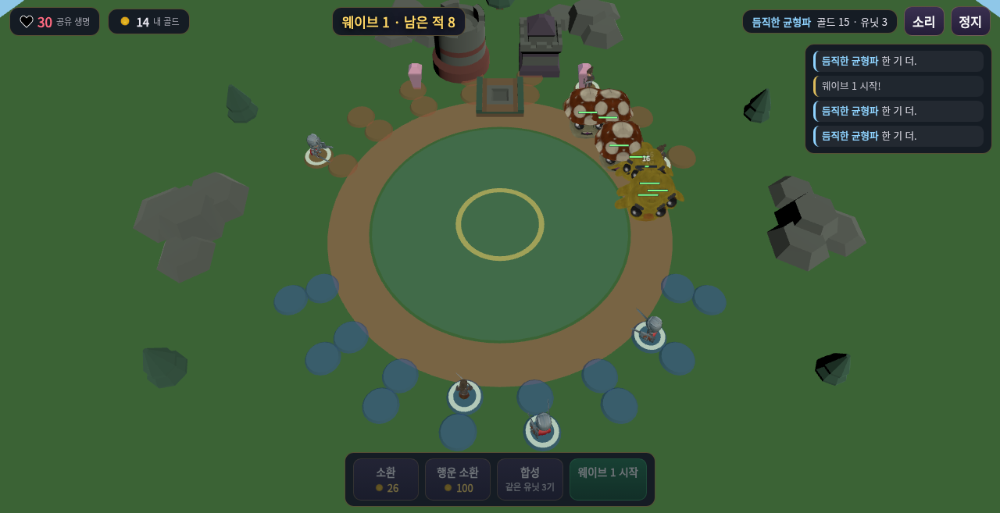

# 포춘 듀오 (Fortune Duo)

AI 파트너와 함께하는 **2인 협동 랜덤 합성 디펜스** — 「운빨존많겜」의 합성·도박·공동방어 재미를 싱글 플레이로. 당신의 반쪽은 AI 동료가 같은 규칙으로 지킵니다.

**플레이**: GitHub Pages로 배포되면 `https://sigco3111.github.io/fortune-duo/` 에서 바로 플레이할 수 있습니다.

## 게임 방법

- 몬스터는 상단 성문에서 나와 **원형 트랙을 한 바퀴** 돕니다. 한 바퀴를 완주하면 성문이 뚫려 **공유 생명**이 닳습니다 (생명 0 = 패배).
- **아래 절반**이 당신의 진영, **위 절반**은 AI 파트너의 진영입니다. 막타 골드는 친 사람이 가져갑니다.
- **소환**: 골드로 랜덤 유닛 배치 (소환할수록 비용 상승).
- **합성**: 같은 유닛 3기 → 상위 등급 랜덤 유닛 1기.
- **행운 소환**: 100골드 도박 — 고급~전설 등급이 나올 수도, 꽝일 수도.
- **구역제 대형**: 각 진영은 진행 순서 6개 구역 × 전열·중열·후열 3열(18타일)입니다. **전열**(안쪽)은 담당 구역의 적에게 피해 +25%로 집중 공격하고, **중열**은 균형, **후열**(바깥)은 사거리 +50%로 좌우 3구역을 커버하지만 피해 -15%이며 원거리·마법 유닛만 배치할 수 있습니다(근접은 트랙에 닿지 않음). **근접 유닛은 전열 전용**입니다(중열·후열에서는 트랙까지 사거리가 닿지 않아 배치가 차단됨). 한 구역에 전·중·후열이 모두 차면 그 구역 유닛 공격 속도 +10%.
- 유닛을 눌러 선택하고 다른 타일을 누르면 이동/교환.
- **자동 웨이브**: 첫 웨이브만 수동으로 시작하고, 이후 웨이브는 6초 정비 후 자동 시작됩니다(보스 전 8초). 카운트다운 중에는 **즉시 시작**으로 앞당길 수 있습니다. 5의 배수 웨이브에는 보스가 나옵니다.
- 상단 **1x/2x** 버튼으로 배속 전환. 상단 **구역 표시등**이 빨간색이면 적이 지나는데 커버 유닛이 없는 위험 구역이며, AI 파트너는 위험 구역 담당 타일부터 우선 보강합니다. 표시등을 누르면 그 구역에 **보강 핑**(파란 불빛)을 찍어 AI 파트너에게 우선 대응을 요청할 수 있습니다(한 번 더 누르면 해제, 커버가 확보되면 자동 해제). AI 파트너는 여유가 생기면 위험·핑 구역으로 유닛을 옮겨 대응하기도 하며(성격에 따라 다름), 전·중·후열이 모두 찬 구역은 타일이 밝게 빛납니다. 보스 웨이브는 3초 전 배너로 예고됩니다. 상단 **대형** 버튼을 누르면 3열x6구역 배치 패널(칸당 44px 이상)이 열려 유닛 선택/이동/교환과 불가 사유를 명확히 확인할 수 있습니다. 몬스터 이동 속도(한 바퀴 55→40초)와 웨이브 편성이 전보다 빠르게 조정되었고, 킬 골드·클리어 보너스도 템포에 맞춰 재조정되었습니다. 또한 같은 적을 연속 타격하는 **데미지 숫자는 짧은 창으로 합산 표시**하고 타격 이펙트는 대상·시간당 표시를 제한해, 고밀도 전투와 2x 배속에서도 기본 공격 피드백은 사라지지 않게 하면서 화면 가독성을 지킵니다.

## AI 파트너 성격 6종

| 성격 | 행동 |
|---|---|
| 듬직한 균형파 | 소환·합성·도박을 고르게 |
| 성급한 공격파 | 골드를 모으지 않고 바로 소환·도박 |
| 짠돌이 저축파 | 최소 유닛으로 버티며 모았다가 고티어 도박 |
| 합성 장인 | 판을 채우고 합성 최우선 |
| 든든한 지원파 | 근접/원거리 배치 최적화, 방어 중시 |
| 눈치 빠른 적응파 | 웨이브·남은 생명을 보고 전략 전환 |

성격에 따라 실제 의사결정(소환 타이밍, 도박 빈도, 합성 우선도, 재배치)과 대사가 달라집니다. 최고 기록은 브라우저(localStorage)에 저장됩니다.

## 사용 에셋 (모두 CC0)

- **KayKit – Adventurers** (Kay Lousberg): 유닛 모델 (CC0)
- **Quaternius – RPG Characters / Cute Animated Monsters**: 유닛·몬스터 모델 (CC0)
- **Kenney – Tower Defense Kit / Casino Audio / Interface Sounds / Music Jingles / RPG Audio**: 아레나·타워·효과음 (CC0)
- 기타 CC0 아이콘(젬/코인/스탯), 배경음악 Fantasy Orchestral Theme (CC0)
- Three.js (MIT)

모든 3D 모델·사운드·아이콘은 CC0/CC-BY-free 라이선스 원본을 확인한 에셋 라이브러리에서 가져왔습니다.

## 에셋 파일명 매핑 (운영 메모)

웹 업로드 도구 제약으로 1MB 이상 대용량 에셋 11개는 저장소에서 접두사 파일명을 유지한다. 코드(src/data.js, src/main.js)가 아래 이름을 직접 참조하며, 내용은 원본 에셋과 git blob SHA가 동일하다.

- assets/units/1-Barbarian.glb … 10-Wizard.gltf (유닛 모델 10개, 숫자 접두사)
- assets/audio/11-bgm.mp3 (배경음악)

대용량 바이너리를 GitHub 웹 편집 UI로 rename하면 내용이 깨지므로(2바이트로 덮어씀) 위 파일들은 웹 UI로 이름을 바꾸지 말 것.
